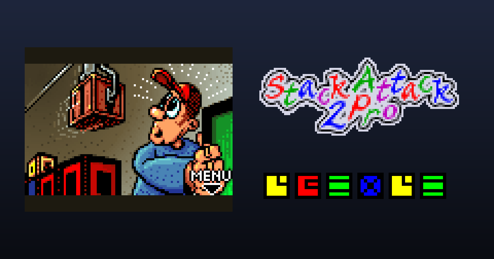

# Stack Attack 2 — web port

Port para navegador do **Stack Attack 2 Pro**, o jogo de empilhar caixas que vinha nos celulares
Siemens (série 55, 2003 — Mobile Scope AG). Feito a partir do `.jar` original (MIDlet v1.08),
com controles touch de verdade, suporte a teclado e gamepad e um menu de opções no estilo
*Ship of Harkinian*.

**▶ Jogar:** https://erereck.github.io/stack-attack-2-web/



## Fidelidade

- **Lógica traduzida linha a linha do bytecode** (classes `e`, `g`, `i`, `j`, `l` do MIDlet), incluindo
  o `java.util.Random` reimplementado bit a bit, o loop de 111 ms por quadro e até as esquisitices
  do original (caixas que trocam de slot antes de cair, a caixa de personagem que nunca some, etc.).
- **Verificado contra o jogo original**: em [`tools/fidelity`](tools/fidelity) há um teste que roda o
  bytecode original numa JVM, com stubs das APIs MIDP/Siemens, lado a lado com este port — mesma
  semente, mesmas teclas — e compara o estado inteiro a cada quadro. Resultado: 36 de 36 partidas
  idênticas (~130 mil quadros), com todos os personagens e níveis.
- **Gráficos, textos e sons originais**: as imagens saem do `res.bin`/`restit.bin`; os textos dos
  5 idiomas do `.jar` (EN, DE, ES, PT, PL) mais uma tradução nova em **português do Brasil**;
  os efeitos SMAF foram decodificados do ADPCM da Yamaha e os MIDIs tocam num sintetizador
  FM de 2 operadores, como o chip Yamaha MA dos aparelhos.
- **Interface do celular recriada**: listas, formulários, caixas de texto e teclas de função no estilo
  Siemens, com uma fonte bitmap própria; telas de abertura (Siemens → Mobile Scope → logo quicando)
  e a barra de "Carregando" com a fórmula de cor do original.

## Controles

| Ação | Teclado | Gamepad | Toque | Celular |
|---|---|---|---|---|
| Andar / empurrar | ← → ou A D | Direcional / analógico | Direcional | 4 · 6 |
| Pular (para o lado se segurar ← →) | ↑, W, Espaço | A | PULAR / direcional ↑ ↖ ↗ | 2 (1 · 3) |
| Superpulo | Shift, X | B | SUPER | 5 |
| Soltar bomba (Sam) | C, B | X | BOMBA | * |
| Pausa | P | Start | PAUSA | 0 |
| Opções de som/vibração | Enter | Y | OK | joystick |
| Encerrar partida | Delete / End | — | menu do port | tecla vermelha |
| Menu do port | Esc | Select | ☰ | — |
| Tela cheia | F | — | ⛶ | — |

As teclas numéricas (fila de cima ou teclado numérico) funcionam como no celular. Tudo pode ser
remapeado em *Menu do port → Controles*. Nos menus, toque direto nos itens.

## Extras do port

- **Vídeo:** tela cheia, *widescreen* com painel lateral (pontos, recorde, tempo, guindastes), modo
  *widescreen de campo largo* com 17 colunas, escala ajustável/inteira/esticada, filtros (grade de LCD,
  scanlines, suave), rastro de LCD, paletas (LCD de celular, verde clássico, cinza, vívidas, noturno),
  moldura de celular ou celular completo com teclado clicável, movimento suave a 60 fps (interpolação
  visual, sem mudar a jogabilidade), contador de FPS.
- **Jogo:** velocidade de 50% a 200%, buffer de comandos (toques rápidos não se perdem), pulo direcional,
  pontuação na tela, guia de onde as caixas vão cair, **sons restaurados** (o `.jar` traz dois efeitos que
  o jogo nunca toca), correção opcional de bugs do original, música durante a partida, desafio diário
  (mesma sequência de caixas para todo mundo no dia), **save states**.
- **Áudio:** volumes separados, modo "bipes" (o caminho de código para celulares sem SMAF), sintetizador
  FM ou onda quadrada, simulação do alto-falante do celular.
- **Controles:** gamepad virtual com deslize entre direções, celular completo com teclado, tamanho e
  opacidade dos botões, vibração háptica, vibração do jogo no aparelho, remapeamento de teclas, gamepad.
- **Trapaças:** todos os personagens, vidas/superpulos infinitos, capacete permanente, vidas iniciais.
- **Recordes:** o recorde original (com apelido) + ranking local das melhores partidas, estatísticas,
  exportar/importar o save, compartilhar a pontuação.
- **PWA:** funciona offline e pode ser instalado na tela inicial do celular.

## Bugs do original

- Combos de 9 ou mais caixas acessavam a tabela de pontos fora do limite e **travavam o MIDlet** — no
  port a pontuação fica limitada ao maior valor (500). Isso acontece sempre, mesmo sem "Corrigir bugs".
- A descida diagonal para a esquerda (`l()`) checava a coluna da direita; na borda direita isso também
  estourava o array. O port evita o crash e, com *Corrigir bugs*, faz a checagem certa.

## Rodando localmente

É um site estático, sem build. Qualquer servidor serve:

```bash
python -m http.server 8000
```

e abra `http://localhost:8000`.

## Créditos e direitos

Stack Attack 2 © Siemens AG / Mobile Scope AG, 2003. Gráficos, textos, músicas e efeitos sonoros
pertencem aos seus donos. Este é um port não oficial, feito por fãs, sem fins lucrativos, para
preservação. O código do port (pasta `js/`, `css/`, ferramentas) é livre para estudo e modificação.
